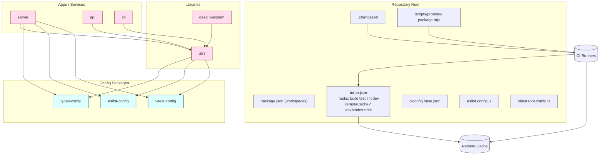

# Universal Turborepo + Bun Monorepo Template

> Objective: Maintain ONE template that starts as a single-package repo and scales seamlessly into a full monorepo with minimal cognitive + operational overhead, optimized for focus (ADHD-friendly), speed (task graph + caching), and reliability (typed, tested, governed).

## 1. Rationale & Principles

- Single starting point; add packages via script ("promote") when complexity emerges.
- Centralize config (TS, ESLint, Vitest) to eliminate divergence.
- Deterministic tasks (build/test/lint/typecheck) with explicit graph & caching.
- Remote cache opt‑in (env gated) for team scaling; local-first works offline.
- Fast feedback: parallelizable tasks, isolated type/build steps.
- Governance: boundaries/tags prevent accidental cross-layer coupling.
- Incremental adoption: each concern (design-system, api, cli) is optional.
- Reduce decision fatigue: documented conventions > ad-hoc choices.

## 2. Repository Layout

```text
root
├─ package.json            # workspaces + scripts (delegating to turbo)
├─ turbo.json              # task graph + cache + boundaries
├─ tsconfig.base.json      # shared compiler settings
├─ eslint.config.js        # flat config, consumes @repo/eslint-config
├─ vitest.root.config.ts   # root test aggregator
├─ .changeset/             # versioning (initialized when >1 pkg)
├─ scripts/
│  └─ promote-package.mjs  # scaffold & link new package
└─ packages/
   ├─ config/
   │  ├─ typescript/ (types-config)   # exports tsconfigs
   │  ├─ eslint/ (eslint-config)      # exports eslint presets
   │  └─ vitest/ (vitest-config)      # shared vitest utils
   ├─ utils/                          # first library (initial single pkg)
   ├─ server/                         # (later) runtime service
   ├─ api/                            # (later) edge/http api
   ├─ cli/                            # (later) developer CLI
   └─ design-system/                  # (optional) component lib
```

## 3. Task Graph (turbo.json core)

Key patterns:

- build depends on parent builds: "^build".
- test depends on build outputs (for transpiled code) or typecheck.
- lint & typecheck run in parallel; both prerequisites for build if desired.
- dev is non-cacheable (persistent).
- outputs enumerated for caching: dist/**, .next/**, coverage/\*\*.

Example minimal turbo.json:

```json
{
  "$schema": "https://turbo.build/schema.json",
  "pipeline": {
    "typecheck": {
      "cache": true,
      "outputs": []
    },
    "build": {
      "dependsOn": ["^build", "typecheck"],
      "outputs": ["dist/**", "build/**"],
      "env": ["NODE_ENV"],
      "cache": true
    },
    "lint": { "cache": true },
    "test": {
      "dependsOn": ["build"],
      "outputs": ["coverage/**"],
      "cache": true,
      "env": ["CI"]
    },
    "dev": { "cache": false, "persistent": true }
  },
  "globalEnv": ["TURBO_API", "TURBO_TEAM"],
  "remoteCache": {
    "signature": true,
    "timeout": 3000,
    "enabled": "process.env.TURBO_REMOTE === '1'"
  },
  "envMode": "strict"
}
```

## 4. Bun Integration

- Use Bun primarily for dev (fast installs + scripts) while retaining Node compatibility.
- Scripts call `bun run` where speed matters; fall back to `node` for cross-env tools if required.
- Ensure TS emits CJS/ESM as needed (Bun handles ESM well; align module to `moduleResolution: bundler`).
- Avoid Bun-specific APIs in shared libs unless locked in; isolate behind adapters if used.

Root scripts (package.json excerpt):

```json
{
  "private": true,
  "workspaces": ["packages/*"],
  "packageManager": "bun@1.1.0",
  "scripts": {
    "dev": "turbo run dev --parallel",
    "build": "turbo run build",
    "test": "turbo run test",
    "lint": "turbo run lint",
    "typecheck": "turbo run typecheck",
    "release": "changeset version && changeset publish",
    "promote": "bun scripts/promote-package.mjs"
  },
  "devDependencies": {
    "turbo": "^2.0.0",
    "typescript": "^5.5.0",
    "eslint": "^9.0.0",
    "vitest": "^1.6.0",
    "@changesets/cli": "^2.27.0"
  }
}
```

## 5. Shared Config Packages

### types-config

Exports layered tsconfigs: base.json (compiler), lib.json (references base + emit), app.json (tsx + jsx), test.json (vitest globals). Consumers extend: `"extends": "@repo/types-config/lib.json"`.

### eslint-config

Single entry exports flat config array. Includes TypeScript, import ordering, security (optional), turbo plugin for task boundaries.

### vitest-config

Exports `defineConfig` helper with jsdom/node env toggles + coverage defaults.

Benefits: versioned, changelogged (Changesets), easy cross-repo reuse.

## 6. Versioning & Releases (Changesets)

- Initialize only when adding second package (until then plain semver in root).
- Author change: `bun changeset` → selects affected pkgs.
- Pre-release mode for betas: `changeset pre enter beta`.
- CI steps:
  1. Install (cache lockfile).
  2. `turbo run build test lint`.
  3. If main branch & changesets pending: `changeset version` → commit → publish (npm / internal registry).

## 7. Remote Caching Strategy

- Disabled by default locally unless `TURBO_REMOTE=1`.
- Provide Vercel or self-host credentials via env (`TURBO_TEAM`, `TURBO_TOKEN`).
- Signature on to detect platform drift.
- Timeout short (3s) to avoid blocking developer flow.
- Document opt-in in README to avoid confusion.

## 8. Boundaries & Dependency Governance

Tag packages via `package.json` custom field (e.g., `"role": "config|lib|app|cli|design").

Rules:

- app/cli may depend on lib & config.
- lib must not depend on app/cli.
- config depends only on nothing external (except dev tooling).
- design-system depends on lib but not on server/api.

Automate with a lightweight script or ESLint custom rule leveraging import paths & role tags.

## 9. Promotion Workflow (single → multi)

1. Start with `packages/utils` only (core domain code + maybe runtime entry).
2. Need a server? Run `bun promote server`.
3. Script: scaffolds folder, package.json (private), tsconfig, index.ts, test skeleton, updates README table.
4. Optionally adds Changeset if multi now.
5. Developer runs `bun dev` – new package integrated via workspace automatically.

Script spec (promote-package.mjs outline):

- Parse args (name, type=lib|app|config?).
- Validate name (kebab-case).
- Template selection.
- Write files; if second non-config package, ensure `.changeset` initialized.
- Log next steps (add exports, create changeset, run build).

## 10. CI Pipeline (GitHub Actions / Azure DevOps Analog)

Stages:

- Setup: checkout, setup bun (cache), install.
- Affected fast checks: `turbo run lint typecheck --filter=...[HEAD^1]` (optional)
- Full tasks: `turbo run build test` (leveraging remote cache).
- Upload coverage artifact.
- Release (on main): changesets version + publish.
- Cache keys: lockfile hash + turbo global cache folder.
- Parallel matrix (optional): split test vs build if long-running.

## 11. Environment & Secrets

- envMode strict prevents silent fallbacks.
- Root `.env.example` documents shared vars.
- Per-service `.env.local` ignored by VCS.
- Use schema validation (zod) in each service bootstrap; fail fast.
- Avoid leaking secrets into cache (limit env passed to tasks via `env` whitelist in turbo.json).

## 12. Testing Strategy (Vitest)

- Root collects coverage; per package minimal config.
- Use `--changed` (when supported) for focused runs locally.
- Libraries: pure unit heavy; Services: add integration harness (supertest / fetch) behind fast startup.
- Snapshot discipline: update via explicit command; track in review.

## 13. Performance Patterns

- Prefer type-only packages (no emit) where feasible; rely on project references.
- Split typecheck from build to exploit parallel caching.
- Keep dependency trees shallow early (one lib → one app) for faster cold starts.
- Use Bun install for speed; lock to version in packageManager field to ensure reproducibility.

## 14. ADHD-Friendly Operational Conventions

- One canonical doc (this) at root; link in README.
- Scripts with verbs: `promote`, `release`, `typecheck`, avoiding ambiguous names.
- Color-coded task output (turbo already groups) – optionally add `--filter` aliases.
- Checklist PR template (scaffolded separately) to reduce memory load.
- Strict config packages = fewer repeated decisions.

## 15. Risk & Mitigations

| Risk                   | Impact               | Mitigation                                      |
| ---------------------- | -------------------- | ----------------------------------------------- |
| Over-engineering early | Slower start         | Start with single utils only; promote on need   |
| Bun edge-case incompat | Build failures       | Keep Node fallback scripts; test in CI Node env |
| Config package drift   | Inconsistent builds  | Version via Changesets; depend exact range      |
| Remote cache flakiness | Slow dev             | Short timeout + local fallback                  |
| Boundary bypass        | Architecture erosion | ESLint + CI rule enforcing role graph           |

## 16. Future Extensions

- Add `docs/` site powered by typed content pipeline.
- Add `@repo/bench` package for performance regression tracking.
- Introduce task to generate dependency graph artifact (mermaid) automatically.

## 17. Mermaid Architecture Diagram



## 18. Adoption Steps (Quick Start)

1. Clone template → remove unused packages except `utils`.
2. Run `bun install` (fast workspace bootstrap).
3. Implement core logic inside `utils`.
4. Add server later: `bun promote server`.
5. Opt into remote cache: export credentials + `TURBO_REMOTE=1`.
6. On second package introduction: initialize Changesets.
7. Enforce boundaries: add role fields + enable ESLint rule.

## 19. Success Criteria

- Cold build < 10s initial (single package) on average dev machine.
- Adding new package: < 30s end-to-end scaffold to first passing build.
- Remote cache hit rate > 70% in CI after baseline warm-up.
- Zero ungoverned cross-layer imports (lint enforced).

---

Live long and refactor less.
